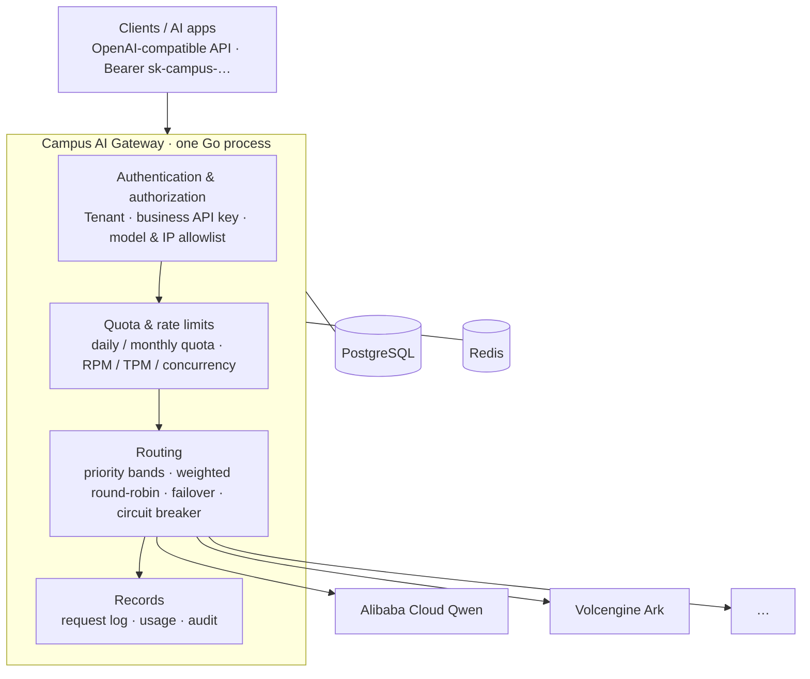

<div align="center">

# Campus AI Gateway

**One OpenAI-compatible endpoint in front of many model providers.**

<sub>Tenants · API keys · Quota · Rate limits · Routing · Failover · Circuit breaker · Audit · Admin console</sub>

[English](README.md) · [简体中文](README.zh-CN.md)

[](https://github.com/Jiusheng01/campus-ai-gateway/actions/workflows/ci.yml)
[](go.mod)
[](LICENSE)

</div>

---

A single Go process with PostgreSQL and Redis. Callers keep speaking the OpenAI API; the gateway resolves the model to a provider, injects that channel's credential, and streams the answer back untouched.

> Not a chatbot, an agent framework or a knowledge base. It is the layer underneath one: **unified model access + access control + routing + quota + audit + an admin control plane.**

## Capabilities

<table>
<tr>
<td width="50%" valign="top">

### 🔑 The Tenant is the boundary

Quota, rate limits (RPM / TPM / concurrency) and audit are defined on the Tenant, so a department has **one budget**, not one per API key. Every key under it shares the same ceiling.

</td>
<td width="50%" valign="top">

### 🔀 Routing that survives a bad channel

Priority bands, smooth weighted round-robin inside a band, a per-provider circuit breaker that skips a failing channel, and a recorded attempt chain for every request.

</td>
</tr>
<tr>
<td width="50%" valign="top">

### 🔌 Add a provider, don't touch clients

One OpenAI-compatible surface for every provider. Register a channel in the console — paste the vendor API key (sealed and write-only) or reference an environment variable — and bind it to a virtual model; callers never learn it changed.

</td>
<td width="50%" valign="top">

### 🛡️ Fail-closed by default

An empty model allowlist denies everything; an inline channel key is sealed with AES-256-GCM and never read back; an environment-variable credential may not point at a gateway-owned variable; and enforcement state that cannot be read refuses the request rather than admitting it.

</td>
</tr>
<tr>
<td width="50%" valign="top">

### 📊 Audit you can defend

Business request logs, admin audit and security events are separate record classes with separate durability, and no upstream response body is ever stored.

</td>
<td width="50%" valign="top">

### 🖥️ An admin console, included

A React console embedded in the Go binary: tenants, API keys, channels, routes, usage, audit. Session auth with Argon2id, five RBAC roles, and a trusted-header path for campus SSO. A personal console at `/console` gives each member their own keys, tenant-scoped models, usage and request logs.

</td>
</tr>
</table>

## Architecture



The data plane is in-process — there is no sidecar and no second gateway to synchronise with. PostgreSQL holds the control-plane state and the records; Redis holds the live counters (rate limits, quota projections, login throttling).

## Quick start

Requirements: **Go 1.24+**, **Docker Desktop**, **Node.js 22+** (to build the console).

Windows (PowerShell):

```powershell
git clone https://github.com/Jiusheng01/campus-ai-gateway.git
cd campus-ai-gateway
.\scripts\setup.ps1          # first run: PostgreSQL / Redis + initialise
.\scripts\dev.ps1            # day to day
.\scripts\status.ps1         # what is running
.\scripts\stop.ps1           # stop
```

Docker Compose. The gateway refuses a placeholder or short `API_KEY_HMAC_SECRET`, so compose has no default for it. Generate one once with `openssl rand -base64 48`, export it, and keep it — changing it later invalidates every stored API key:

```bash
export API_KEY_HMAC_SECRET="$(openssl rand -base64 48)"   # generate once and keep
docker compose -f deploy/docker-compose.yml up -d --build
```

**Where your data lives.** Administrators, tenants, API keys, channels, models, routes and the audit/request records are stored in the Docker named volume `deploy_postgres_data`, not in the repository. The compose file has no top-level `name:`, so Compose derives the project name from the `deploy/` directory (`deploy`) — **every checkout on this machine attaches to the same project and the same volumes by default.** A second clone therefore starts with whatever the first one created; that state is not a seed in the repository. To isolate a checkout, give it its own project name (Compose derives distinct volumes from it):

```powershell
$env:COMPOSE_PROJECT_NAME = "campus-gateway-sandbox"
.\scripts\setup.ps1
```

```bash
docker compose -p campus-gateway-sandbox -f deploy/docker-compose.yml up -d --build
```

To start over from an empty database, run `.\scripts\reset.ps1` (it asks for confirmation unless you pass `-Force`). It removes the stack **with its volumes** and then starts it again through the normal path, so migrations rebuild an empty schema. Nothing is deleted when the gateway starts, and the migrations contain no seed data.

Then open <http://127.0.0.1:8080/admin-ui> and create the first administrator there. **There is no built-in account or default password.**

The first hop stays in the console: **create the first administrator → add a channel (paste the vendor API key into the password field) → publish a model from that channel's candidate list on the 对外模型 page → call it**. The 模型服务 group is 服务概览 / 上游渠道 / 对外模型 / 路由策略 / 调用管理 / 调用日志: 上游渠道 manages access and credential source, 对外模型 lists the published virtual models and publishes a new alias from a channel's candidates, 路由策略 shows the route set behind each alias, and 调用管理 issues API keys and sets tenant quota. The key is sealed with AES-256-GCM on save and never returned — the console only shows that it is configured and its last four characters. If you would rather use an environment variable, switch the channel to "reference an environment variable" and enter its name instead.

> All configuration comes from **process environment variables**; no `.env` file is read. Provider API keys are the exception: paste them into the channel form and the gateway seals them in PostgreSQL. [`.env.example`](.env.example) is a reference list of names — see [Configuration](doc/configuration.md).

> **Upgrade note — provider egress.** A channel `base_url` must be `https://`. A plaintext `http://` target is rejected unless its host is listed in `PROVIDER_HTTP_ALLOWLIST`; existing `http://` channels must move to HTTPS or be allowlisted. Loopback targets cannot be allowlisted — they are always denied before a connection is made.

## Call the API

Create a tenant and a business key in the console, set the key's model allowlist, then:

```bash
curl http://127.0.0.1:8080/v1/chat/completions \
  -H "Authorization: Bearer sk-campus-..." \
  -H "Content-Type: application/json" \
  -d '{
    "model": "campus-smart",
    "messages": [{"role": "user", "content": "Hello"}],
    "stream": false
  }'
```

## Documentation

Operator documentation is written in Chinese.

| | |
| --- | --- |
| [**Configuration**](doc/configuration.md) | environment variables, provider presets, credential rules, production secrets |
| [**Authentication**](doc/authentication.md) | first-run setup, sessions, registration, RBAC, trusted-header / SSO |
| [**Operations**](doc/operations.md) | local development, migrations, console build, testing and acceptance |
| [**Design & roadmap**](doc/design.md) | the data plane, the record model, known limits and what is next |

## Status

Runnable and manageable today: Qwen has been exercised end to end and Volcengine Ark connectivity is verified. Deliberately frozen for now — campus IdP acceptance, multi-gateway / PostgreSQL / Redis HA, embedding and ASR providers, and the 30,000 RPM target. See [design & roadmap](doc/design.md).

## License

MIT — see [LICENSE](LICENSE).
  