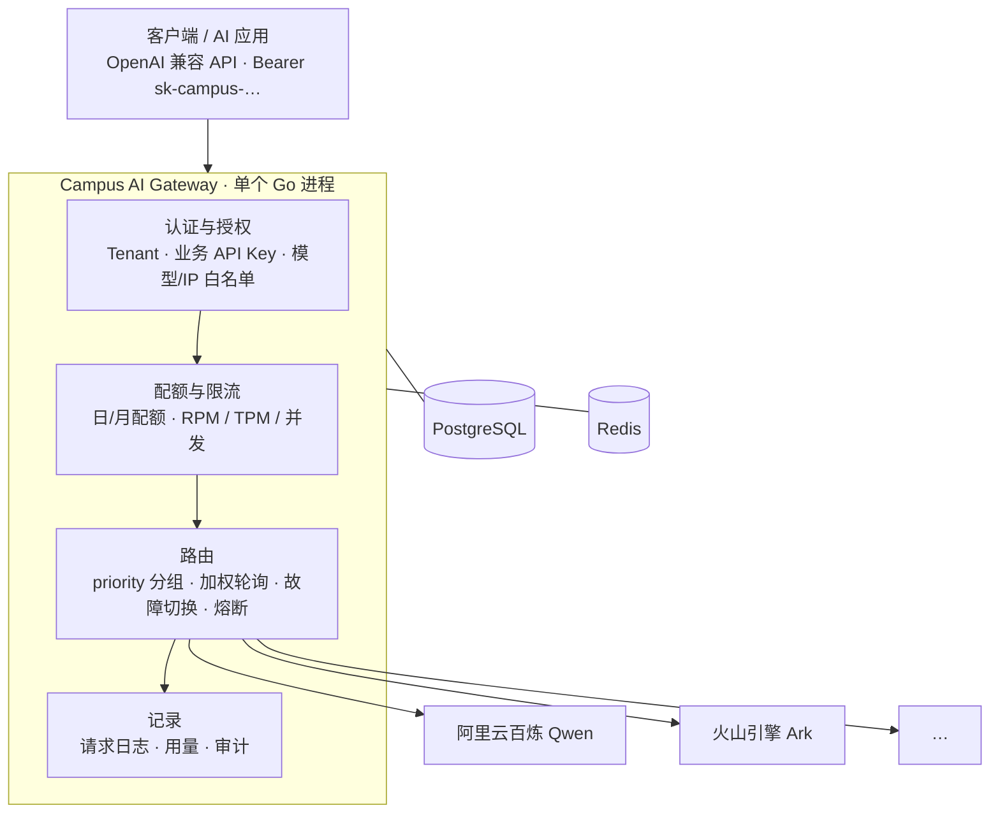

<div align="center">

# Campus AI Gateway

**对多个模型供应商，提供统一的 OpenAI 兼容入口。**

<sub>租户 · 业务 API Key · 配额 · 限流 · 路由 · 故障切换 · 熔断 · 审计 · 管理控制台</sub>

[English](README.md) · [简体中文](README.zh-CN.md)

[](https://github.com/Jiusheng01/campus-ai-gateway/actions/workflows/ci.yml)
[](go.mod)
[](LICENSE)

</div>

---

单个 Go 进程 + PostgreSQL + Redis。调用方始终只说 OpenAI 格式的 API；网关把模型解析到某个供应商，注入该渠道的凭据，并把响应原样流式回传。

> 不是聊天机器人、智能体框架或知识库。它是这些东西**下面那一层**：**统一模型接入 + 访问控制 + 路由治理 + 配额 + 审计 + 管理控制面。**

## 能力

<table>
<tr>
<td width="50%" valign="top">

### 🔑 以 Tenant 为边界

配额、限流（RPM / TPM / 并发）与审计都定义在 **Tenant** 上，所以一个院系是**一份预算**，而不是每把 API Key 一份。同一租户下的所有 Key 共享同一个上限。

</td>
<td width="50%" valign="top">

### 🔀 渠道出问题也扛得住

按 `Route Priority` 分组，同组内做平滑加权轮询；per-provider 熔断跳过故障渠道；每个请求都留下完整的 attempt chain。

</td>
</tr>
<tr>
<td width="50%" valign="top">

### 🔌 加渠道，不用动调用方

对所有供应商只有一个 OpenAI 兼容入口。在控制台注册渠道——直接粘贴厂商 API Key（加密入库、只写不读），或改为引用环境变量——再绑定到虚拟模型即可，调用方无感。

</td>
<td width="50%" valign="top">

### 🛡️ 默认 fail-closed

空模型白名单表示**一个都不允许**；内联渠道 Key 以 AES-256-GCM 加密保存且永不回显；环境变量型凭据不能指向网关自用的变量；读取不到限流状态时**拒绝请求**而不是放行。

</td>
</tr>
<tr>
<td width="50%" valign="top">

### 📊 经得起追问的审计

业务请求日志、管理审计与安全事件是三张彼此分离的记录，耐久级别不同；任何上游响应内容都不写入数据库。

</td>
<td width="50%" valign="top">

### 🖥️ 自带管理控制台

React 控制台直接嵌入 Go 二进制：租户、API Key、渠道、线路、用量、审计。Argon2id 会话认证、五角色 RBAC，以及给校园 SSO 用的 trusted-header 通路。

</td>
</tr>
</table>

## 架构



数据面在网关进程内——没有 sidecar，也没有第二个网关需要同步。PostgreSQL 保存控制面状态与记录；Redis 保存实时计数（限流、配额投影、登录限流）。

## 快速开始

依赖：**Go 1.24+**、**Docker Desktop**、**Node.js 22+**（用于构建控制台）。

Windows（PowerShell）：

```powershell
git clone https://github.com/Jiusheng01/campus-ai-gateway.git
cd campus-ai-gateway
.\scripts\setup.ps1          # 首次：拉起 PostgreSQL / Redis 并初始化
.\scripts\dev.ps1            # 日常启动
.\scripts\status.ps1         # 查看状态
.\scripts\stop.ps1           # 停止
```

Docker Compose。网关会拒绝占位符或过短的 `API_KEY_HMAC_SECRET`，因此 compose 不提供默认值。用 `openssl rand -base64 48` 生成一次并导出、保存好——之后更换它会让所有已存 API Key 失效：

```bash
export API_KEY_HMAC_SECRET="$(openssl rand -base64 48)"   # 生成一次并保存
docker compose -f deploy/docker-compose.yml up -d --build
```

**数据存在哪里。** 管理员、租户、业务 Key、渠道、模型、线路，以及审计与请求记录，都保存在 Docker 命名卷 `deploy_postgres_data` 里，不在仓库中。compose 文件没有顶层 `name:`，项目名取自 `deploy/` 目录（即 `deploy`）——**同机上的每个 checkout 默认共用同一个项目和同一组卷。** 因此第二个 clone 会带着第一个 checkout 创建的数据启动；那不是仓库里的 seed。要隔离某个 checkout，给它一个独立的项目名（Compose 会据此派生独立的卷）：

```powershell
$env:COMPOSE_PROJECT_NAME = "campus-gateway-sandbox"
.\scripts\setup.ps1
```

```bash
docker compose -p campus-gateway-sandbox -f deploy/docker-compose.yml up -d --build
```

要从空数据库重新开始，运行 `.\scripts\reset.ps1`（除非传 `-Force`，否则会要求确认）。它会连同**卷一起**删除整个栈，再走常规启动路径重新启动，由迁移重建空 schema。网关启动时不会删除任何数据，迁移里也没有 seed。

然后打开 <http://127.0.0.1:8080/admin-ui>，在页面里创建第一个管理员。**项目不存在内置账号或默认密码。**

第一跳全部在控制台内完成：**创建管理员 → 新增渠道（把厂商 API Key 粘进密码框）→ 在「对外模型」页从该渠道的候选模型里发布对外模型 → 调用**。「模型服务」组现在是「服务概览 / 上游渠道 / 对外模型 / 路由策略 / 调用管理 / 调用日志」：上游渠道管接入与凭据来源，对外模型列出已发布的对外模型并可从渠道候选里发布新名称，路由策略展示每个名称背后的线路组，调用管理签发 API Key 并设定租户配额。Key 在保存时以 AES-256-GCM 加密入库，之后永不回显——控制台只告诉你「已配置」和尾 4 位。如果更愿意走环境变量，勾选「改为引用环境变量」并填入名称即可。

> 全部配置来自**进程环境变量**，**不读取 `.env` 文件**。Provider API Key 是例外：在渠道表单里粘贴后由网关加密存入 PostgreSQL。[`.env.example`](.env.example) 只是变量名参考清单——见[配置](doc/configuration.md)。

> **升级提示 — Provider 出站**：渠道 `base_url` 必须是 `https://`；`http://` 目标只有在 host 命中 `PROVIDER_HTTP_ALLOWLIST` 时才允许。存量 `http://` 渠道需要迁到 HTTPS 或加入 allowlist。loopback 目标无法加入 allowlist，一律在建立连接前拒绝。

## 调用 API

在控制台创建租户与业务 Key，设置该 Key 的模型白名单，然后：

```bash
curl http://127.0.0.1:8080/v1/chat/completions \
  -H "Authorization: Bearer sk-campus-..." \
  -H "Content-Type: application/json" \
  -d '{
    "model": "campus-smart",
    "messages": [{"role": "user", "content": "你好"}],
    "stream": false
  }'
```

## 文档

| | |
| --- | --- |
| [**配置与凭据**](doc/configuration.md) | 环境变量、Provider 模板、凭据约束、生产密钥 |
| [**认证与账号**](doc/authentication.md) | 首次 Setup、会话、注册、RBAC、trusted-header / 校园 SSO |
| [**运维**](doc/operations.md) | 本地开发、数据库迁移、控制台构建、测试与验收 |
| [**设计、限制与路线图**](doc/design.md) | 数据面、记录模型、已知限制与下一步 |

## 状态

现在就可运行、可管理：Qwen 已完成真实端到端调用，Volcengine Ark 的真实连通已验证。当前**有意冻结**：校园真实 IdP 验收、Multi-Gateway / PostgreSQL / Redis HA、Embedding / ASR 真实 Provider、以及 30,000 RPM 性能目标。详见[设计与路线图](doc/design.md)。

## 许可证

MIT 许可证，见 [LICENSE](LICENSE)。
